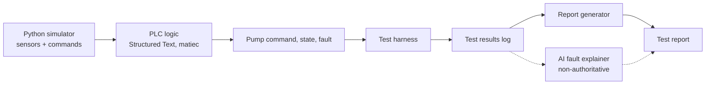
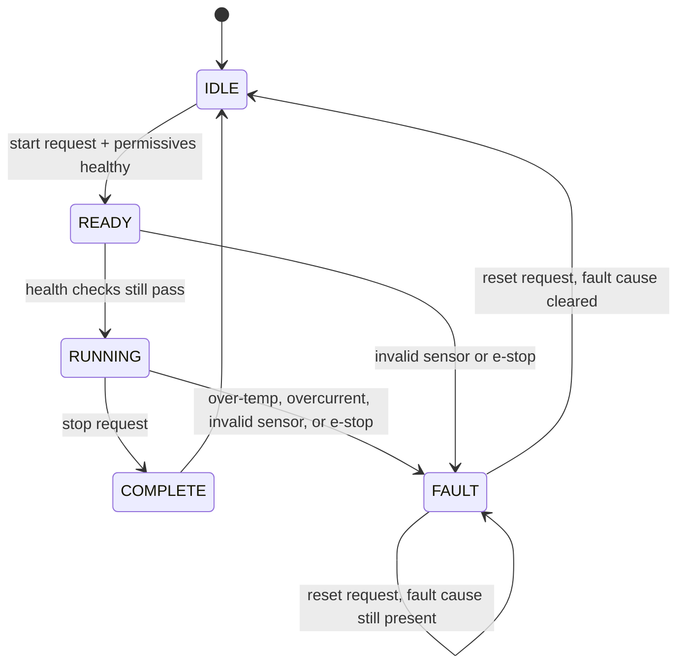

# ADR-001: Component Validation Test Bench

- Status: Accepted
- Date: 2026-10-20

## Context

hxql validates electrical and electronic components for electrified vehicles and industrial machines, faster and more data-driven than manual testing.

## Decision

Build a test bench that validates a component automatically and repeatably, with data backing every pass/fail result. The component (EV coolant pump) is a stand-in — the goal is the validation process, not the specific part.

The PLC is the only thing that decides the pump command and pass/fail. AI may explain faults after the fact but never changes the result.

### Flow

### State machine

### Inputs

| Signal | Type | Source |
|---|---|---|
| Temperature | float, °C | simulated sensor |
| Pressure | float, bar | simulated sensor |
| Motor current | float, A | simulated sensor |
| Sensor health | bool | simulated sensor |
| Start request | bool | simulated operator input |
| Stop request | bool | simulated operator input |
| Emergency stop | bool | simulated operator input |
| Fault reset request | bool | simulated operator input |

### Outputs

| Signal | Type | Meaning |
|---|---|---|
| Pump run command | bool | drives the simulated pump |
| State | enum | IDLE / READY / RUNNING / COMPLETE / FAULT |
| Fault active | bool | true while a fault is latched |
| Fault cause | enum | which condition tripped the fault |

### Constraints

- All I/O is simulated — no physical hardware.
- Limits are configurable, not hardcoded. Placeholder values: temperature trip 90 °C, current trip 12 A, minimum running pressure 0.5 bar.
- A fault stays latched until a reset request is made AND the fault cause has cleared.

### Pass/fail scenarios

| ID | Scenario | Expected result |
|---|---|---|
| TC-01 | Startup | State = IDLE, pump command off |
| TC-02 | Healthy start | State = RUNNING, pump command on |
| TC-03 | Stop request | State = COMPLETE, pump command off |
| TC-04 | High temperature | State = FAULT, pump command off |
| TC-05 | Overcurrent | State = FAULT, pump command off |
| TC-06 | Invalid sensor | State = FAULT, pump command off |
| TC-07 | Emergency stop | Pump command off immediately |
| TC-08 | Reset while fault cause present | Reset rejected, still FAULT |
| TC-09 | Reset after fault cause cleared | State returns to IDLE |
| TC-10 | Report consistency | Report matches individual test results |
