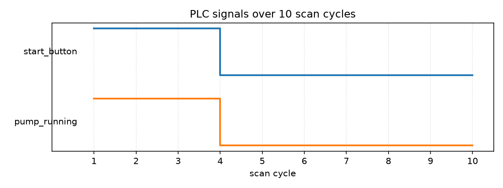

# Learnings

## Structured Text basics

```
PROGRAM main
    VAR
        start_button : BOOL;
        pump_running : BOOL;
    END_VAR

    pump_running := start_button;
END_PROGRAM
```

- `PROGRAM ... END_PROGRAM` — a named block of logic.
- `VAR ... END_VAR` — variable declarations. Everything is typed and declared up front.
- `BOOL` — boolean type. Other base types: `INT`, `REAL` (float), `TIME`.
- `:=` is assignment. `=` is comparison, not assignment.

## Scan cycle

A PLC runs its program in a loop, not as a function you call once:

1. Read all inputs (frozen for this cycle).
2. Run the program once, top to bottom.
3. Write all outputs.
4. Repeat, every few milliseconds.

No event loop or callbacks to write yourself — the runtime loops for you. The code is just one pass through the logic.

## Compiling Structured Text with matiec

`matiec` reads a `.st` file and translates it into C code — the same role a C compiler plays for C, one level up. It's the actual compiler used inside OpenPLC, a real open-source PLC runtime.

Built from source (https://github.com/beremiz/matiec), kept outside the project at `~/tools/matiec` since it's a third-party tool, not project code.

Command used to compile `plc/main.st`:

```
~/tools/matiec/iec2c -I ~/tools/matiec/lib -T plc/build plc/main.st
```

- `-I ~/tools/matiec/lib` — points matiec at its own standard library file it needs to run.
- `-T plc/build` — writes the generated C code into `plc/build/` inside the project.
- `plc/main.st` — the input file.

Output: `plc/build/POUS.c`, `POUS.h`, `GLOBALS.h`, `LOCATED_VARIABLES.h`. `POUS.c` contains the generated C for our one line of logic:

```c
__SET_VAR(data__->,PUMP_RUNNING,,__GET_VAR(data__->START_BUTTON,));
```

That's the C equivalent of `pump_running := start_button;`.

## Why the generated C alone isn't runnable

`matiec`'s output (`POUS.c`) only defines two functions: `MAIN_init__` (sets starting values) and `MAIN_body__` (one scan cycle). Both are declared `static`, meaning they're private to `POUS.c` — no other `.c` file can call them normally. The standard fix (matiec's own examples do this) is to `#include "POUS.c"` directly into a driver file, so it becomes one single file to the compiler.

Also found by reading matiec's headers:

- Each variable in the generated struct isn't a plain `BOOL` — it's `__IEC_BOOL_t`, a struct of `{ flags, value }`. `flags` is for PLC features we don't use (forcing a value, retaining it across power loss). The real TRUE/FALSE is in `.value`. So `main_inst.START_BUTTON.value`, not `main_inst.START_BUTTON`.
- `matiec`'s standard library bundles in implementations for all standard blocks (timers like `TON`/`TOF`) whether or not the program uses them. These reference a shared clock variable, `TIME __CURRENT_TIME;`, which is declared `extern` in `iec_std_lib.h` but never defined — the driver has to provide the actual storage for it, or linking fails.
- `MAIN_data__` (the struct holding our variables) doesn't appear as a literal struct anywhere in the source files — it's created by the C preprocessor, from this macro call in `POUS.h`:
  ```c
  __DECLARE_PROGRAM_TYPE(MAIN,
    __DECLARE_VAR(BOOL,START_BUTTON)
    __DECLARE_VAR(BOOL,PUMP_RUNNING)
  )
  ```
  which `accessor.h` (one of matiec's support headers) expands into a real `typedef struct { ... } MAIN_data__;` before the compiler ever sees it.

## Driver: `plc/driver.c`

A hand-written C file with no PLC logic of its own — it only loads and exercises what `main.st` compiled into. Runs 10 scan cycles, changes `start_button` partway through, prints each cycle, and logs every cycle to a CSV file:

```c
#include "iec_std_lib.h"
#include "accessor.h"
#include "POUS.h"
#include "POUS.c"

#include <stdio.h>

TIME __CURRENT_TIME;

static void print_state(int cycle, MAIN_data__ *m) {
    printf("cycle %2d: start_button=%s, pump_running=%s\n", cycle,
        m->START_BUTTON.value ? "TRUE" : "FALSE",
        m->PUMP_RUNNING.value ? "TRUE" : "FALSE");
}

int main(void) {
    MAIN_data__ main_inst;
    MAIN_init__(&main_inst, 0);

    FILE *log = fopen("plc/build/run_log.csv", "w");
    fprintf(log, "cycle,start_button,pump_running\n");

    for (int cycle = 1; cycle <= 10; cycle++) {
        main_inst.START_BUTTON.value = (cycle >= 1 && cycle <= 3) ? TRUE : FALSE;

        MAIN_body__(&main_inst);

        print_state(cycle, &main_inst);
        fprintf(log, "%d,%d,%d\n", cycle,
            main_inst.START_BUTTON.value, main_inst.PUMP_RUNNING.value);
    }

    fclose(log);
    return 0;
}
```

Compiling and running it by hand (no Makefile):

```bash
gcc -I ~/tools/matiec/lib/C -I plc/build -o plc/build/run_test plc/driver.c
./plc/build/run_test
```

Output:

```
cycle  1: start_button=TRUE, pump_running=TRUE
cycle  2: start_button=TRUE, pump_running=TRUE
cycle  3: start_button=TRUE, pump_running=TRUE
cycle  4: start_button=FALSE, pump_running=FALSE
cycle  5: start_button=FALSE, pump_running=FALSE
cycle  6: start_button=FALSE, pump_running=FALSE
cycle  7: start_button=FALSE, pump_running=FALSE
cycle  8: start_button=FALSE, pump_running=FALSE
cycle  9: start_button=FALSE, pump_running=FALSE
cycle 10: start_button=FALSE, pump_running=FALSE
```

Result lands in `plc/build/run_test` (an ELF binary — real machine code, same format as any Linux program) and `plc/build/run_log.csv`:

```
cycle,start_button,pump_running
1,1,1
2,1,1
3,1,1
4,0,0
5,0,0
6,0,0
7,0,0
8,0,0
9,0,0
10,0,0
```

## Plotting: `plc/plot_cycles.py`

Reads `plc/build/run_log.csv` and draws both signals as a step waveform (logic-analyzer style — each signal its own lane, square transitions), using `matplotlib`:

```bash
python plc/plot_cycles.py
```

Saves `plc/build/waveform.png`:



## Automating all of it: `Makefile`

One file at the project root that chains every step above, so a single command regenerates everything from scratch — no stale files left over from a previous run:

```makefile
MATIEC = $(HOME)/tools/matiec

.PHONY: all generate build run plot clean

all: clean generate build run plot

plc/build:
	mkdir -p plc/build

generate: plc/build
	$(MATIEC)/iec2c -I $(MATIEC)/lib -T plc/build plc/main.st

build: generate
	gcc -I $(MATIEC)/lib/C -I plc/build -o plc/build/run_test plc/driver.c

run: build
	./plc/build/run_test

plot: run
	python plc/plot_cycles.py

clean:
	rm -rf plc/build
```

To replicate everything in this doc from scratch:

```bash
make        # runs clean -> generate -> build -> run -> plot
make clean  # removes plc/build entirely
```

Requires `matiec` built from source at `~/tools/matiec` (see "Compiling Structured Text with matiec" above) and `gcc`/`python`/`matplotlib` already on the system.
